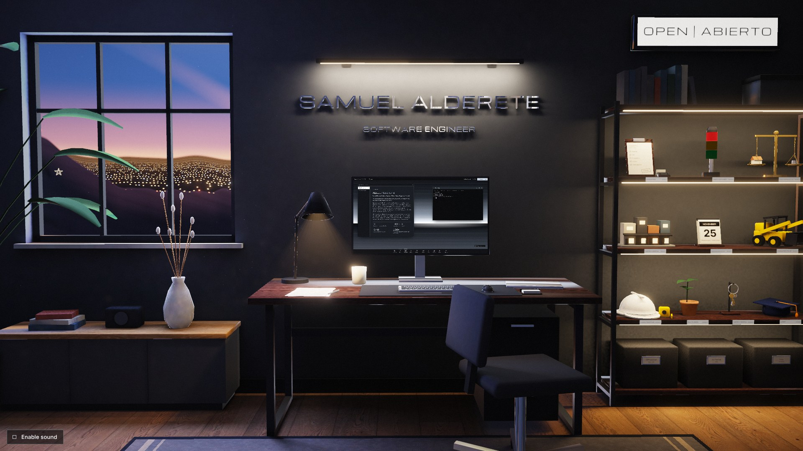

# The studio



A second way into the portfolio, beside the plain site: Samuel's studio at dusk as a 3D room. The
shelves hold the work (a click on a thing opens its card), the window looks over the city, and the
computer on the desk flickers on a moment after the page loads. Click the monitor and the camera
flies in until the screen fills the window: it runs a small operating system with a terminal, a
paint program, a drum pad, a game, notes, films, settings, the inventory, the résumé and contact.
Escape, or "Back to the room", flies back out.

Open `studio/index.html` through any static server (the page uses ES modules, so not from `file://`):

```bash
python3 -m http.server 4318        # from the repo root
# http://127.0.0.1:4318/studio/
```

Nothing is fetched from another site: three.js (r186), the two fonts and every texture are in
`app/`. Sound is off until the visitor chooses "Enable sound", and all of it is made in code.

## Address bar

| | |
|---|---|
| `?t=<seconds>` | Freeze time at that moment. Nothing animates; the same address always gives the same picture. The monitor strikes at 1.5 s and the desktop is up by about 5.5 s. |
| `?view=room\|desk\|shelf\|window\|name\|screen` | Where the camera starts. `screen` starts sitting at the computer. |
| `&card=<id>` | Open a thing's card (`kasapro`, `testharvest`, `loan`, `nerrix`, `gpi`, `kasarentals`, `foreman`, `bwfusion`, `studio`, `utep`, `resume`, `contact`, `gpi-portal`, `tv-home`, `luv`). |
| `&app=<program>` | With `view=screen`: open a program (`terminal`, `paint`, `drums`, `game`, `notes`, `videos`, `settings`, `inventory`, `resume`, `contact`). |
| `&q=1` | Hold full resolution (otherwise the page draws fewer pixels when frames run slow). |

## How it is made

- **The words** are the home page's own, in one file: `app/content.js`. The cards in the room and
  the programs on the screen both read from it. Nothing is said here that the site does not say.
- **The room** is built in code with Blender's Python module: `tools/build_room.py` makes every
  wall, shelf and object from boxes, lathes and a few hand-made meshes. No person is modelled.
  Nothing real has a razor edge, so every box that is not a sheet gets a small chamfer, shaded so
  that its flat faces stay flat and only the chamfer turns (`weighted_normals`); cushions and
  moulded parts are boxes with generously rounded edges, swelled or bent by a small function
  (`soft_box`). Nobody opens Blender for any of this: it runs as a library, from the command line.
- **The light** is baked, not computed in the browser. `tools/bake.py` bakes it with Cycles into
  three atlases (shell, furniture, props), in separate layers: the window at dusk in colour, and
  the desk lamp, monitor glow, shelf strips, lit sign and name light each in their own channel.
  The page draws every surface unlit, as colour times baked light, and mixes the layers live. That
  is how the monitor can flicker on, the lamp can be switched, and the glow in the room can take
  the colour of the screen's wallpaper.
- **Live on top:** the view from the window (a shader, drawn at infinity so the frame slides over
  it), dust in the lamp's cone and by the window, leaves that sway, reflections on the floor, the
  glass and the metal letters (from one Cycles panorama of the room), the sign and the signal light.
- **Surfaces.** The wood is three photographs from Poly Haven. The paint on the walls and the pile
  of the rug are two small grey pictures made in code (`tools/make_textures.py`), each laid over its
  surface twice, fine and coarse, so no repeat shows. Cloth has no shine facing you and a soft
  sheen where it turns away; what each material does is one line in `LOOK`, at the top of
  `app/room/room.js`. A reflection blurs where the surface turns quickly under a pixel, so a
  chamfer a pixel wide shows as one soft line and not as a row of sparks.
- **The screen** is a real page. In the room it is squeezed onto the monitor by a CSS transform
  and seen through a transparent hole in the drawing, so its text is as sharp as the browser can
  make it; when you sit down the transform comes off. The page keeps the window's shape, so on a
  phone it is a tall strip on a wide monitor: there the rest of the glass shows the desktop's
  wallpaper, drawn by the same code as the real one, and the page reads as a window on it.
- **One rule for the shaders.** A real graphics card answers "not a number" to things like `pow()`
  of a negative value, and one such pixel is spread by the glow pass into a black block: a phone
  showed exactly that, from the lamp's cone. The software renderer used for checks here does not,
  so it cannot be seen from a test run. Every shader therefore clamps what it feeds to `pow()` and
  never divides by a value that can be zero, and the finishing pass (`fx.js`) looks for spoiled
  pixels before the glow is made and fills any it finds from their neighbours. The note above
  `ENV_GLSL` in `room.js` says the same next to the code.

## Files

| Path | What it is |
|---|---|
| `index.html` | The page: the canvas, the screen's place behind it, the card, the sound control |
| `app/main.js` | Camera, the first seconds, clicking things, flying in and out, sound |
| `app/content.js` | Every word and fact, taken from the home page |
| `app/room/` | The model (`room.glb`), its baked light (`*.webp`, `light.json`), and the drawing code: `room.js` (materials), `fx.js` (window view, dust, lamp cone, finishing pass), `labels.js` (tags, sign, invoice, calendar, résumé sheet) |
| `app/os/` | The mini-OS on the monitor. `os/dev.html` runs it alone, without the room |
| `app/audio.js` | The one sound engine both share |
| `app/vendor/three/` | three.js r186 and its glTF loader |
| `app/room/tex/` | Wood (photographs) and the paint and rug grain (made by `tools/make_textures.py`) |
| `tools/` | `build_room.py` and `bake.py`: the room and its light, in code; `make_textures.py`: the paint and the rug |

## Baking again

The room needs `bpy` 5.3 (Blender as a Python module, Python 3.13), `numpy`, `pillow` and
`fonttools`. Every job runs on the CPU in well under ten minutes; all of them together take about
half an hour on four cores.

```bash
pip install bpy==5.3.0 numpy pillow fonttools brotli
python -c "from fontTools.ttLib import TTFont; f=TTFont('app/fonts/michroma-latin.woff2'); f.flavor=None; f.save('/tmp/michroma.ttf')"
export STUDIO_FONT=/tmp/michroma.ttf
cd tools
python bake.py build /tmp/room                 # model, light-map layout, app/room/room.glb + room.json
python bake.py pano  /tmp/room 4096 48         # the reflection panorama (kept at half this size)
python bake.py bake  /tmp/room S sky 2048 64   # one job per atlas (S, F, P) and layer (sky, lmb, sgn)
python bake.py pack  /tmp/room                 # writes app/room/*.webp and light.json
python make_textures.py                        # the paint and the rug grain; only if you change them
python bake.py view  /tmp/room out.png 960 48  0.1 -2.3 1.3  0.15 2.2 1.18  35   # a plain Cycles picture, to check the model
```

Change the room in `build_room.py`, then run `build` and every `bake` job again: the layout of the
light maps is made by `build`, so maps from an older build do not fit a newer model.

## Credits

three.js r186 (MIT). Wood textures from Poly Haven (CC0): Wood Floor, Wood Table 001, Oak Veneer 01.
Michroma and Inter (SIL OFL 1.1), as on the site. Everything else is made here.
